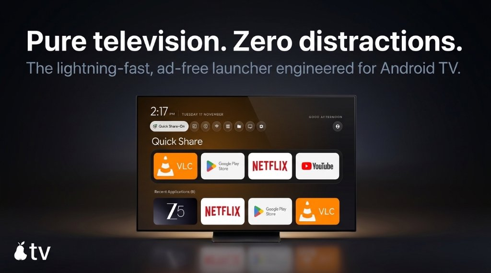
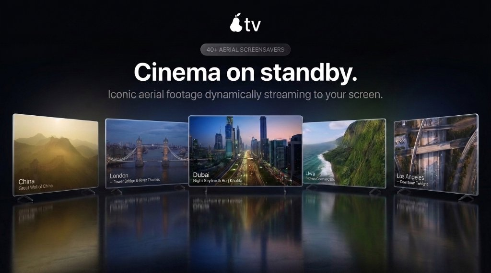
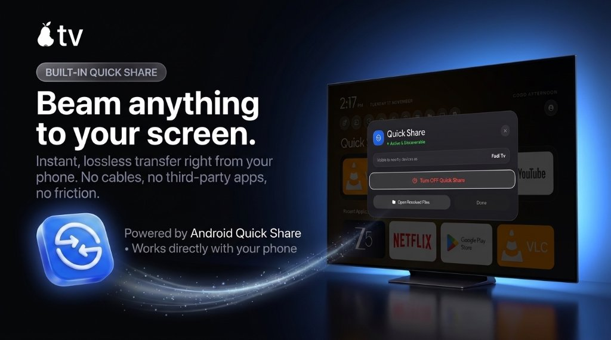
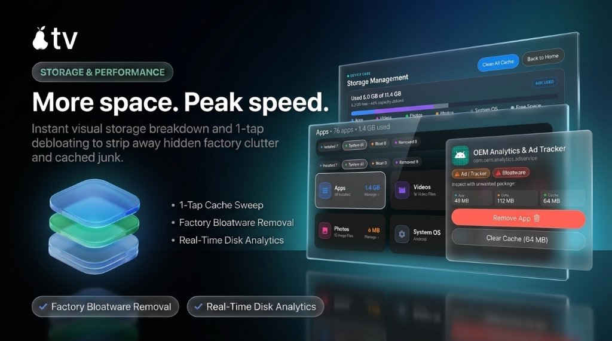
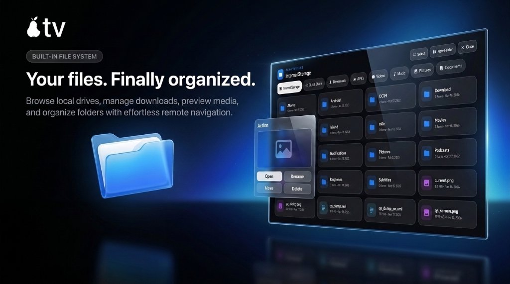
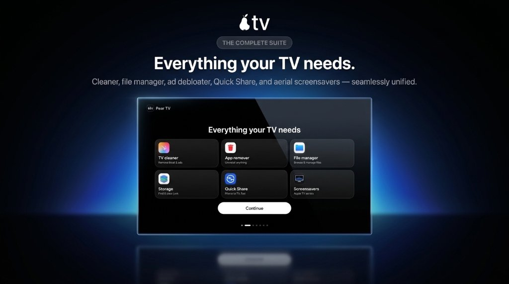
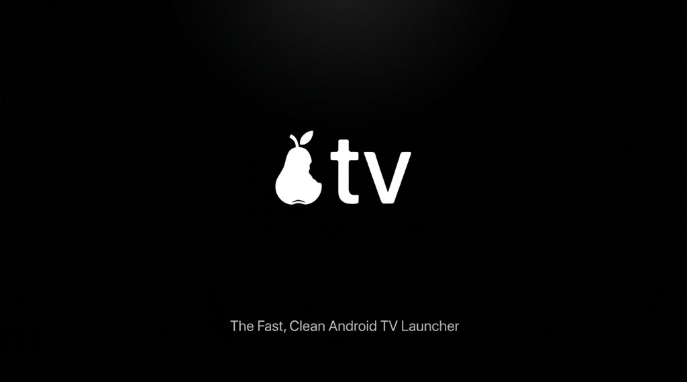

# Pear TV — The Pure, Ad-Free Apple Experience For Android TV

<div align="center">
  
  <br/><br/>
  <p><strong>A lightning-fast, privacy-first, Apple tvOS-inspired launcher for Android TV and Google TV.</strong></p>
  <p>Zero advertisements • Zero sponsored banners • Built-in Quick Share • Safe System Debloater • 4K Apple Aerial Screensavers</p>

  <p>
    <a href="https://github.com/FaysArukattil/PearTV/releases"></a>
    <a href="https://github.com/FaysArukattil/PearTV/actions"></a>
    <a href="https://github.com/FaysArukattil/PearTV"></a>
    <a href="https://faysarukattil.github.io/PearTV/"></a>
  </p>
</div>

---

## 📺 Official Listing Showcase

<div align="center">
  <p><strong>1. Pure Television. Zero Distractions.</strong><br/>
  <em>Ultra-fast, true #000000 AMOLED dark canvas with zero sponsored rows, zero manufacturer recommendations, and instant remote responsiveness.</em></p>
  

  <br/><br/>

  <p><strong>2. 40+ 4K Aerial Screensavers</strong><br/>
  <em>Iconic Apple TV drone cinematography streaming verified 4K landscape flyovers (Dubai, London, China, Hawaii, Los Angeles) with OLED burn-in protection.</em></p>
  

  <br/><br/>

  <p><strong>3. Built-In Wireless Quick Share Receiver</strong><br/>
  <em>Direct peer-to-peer file transfer straight from your Android phone or tablet. Send APKs, videos, and photos with no cables, no cloud, and no extra apps.</em></p>
  

  <br/><br/>

  <p><strong>4. Storage & Performance (Device Care)</strong><br/>
  <em>Real-time disk analytics, multi-segmented storage visualization, 1-tap cache sweep, and on-device safe factory bloatware removal.</em></p>
  

  <br/><br/>

  <p><strong>5. Built-In Remote File System</strong><br/>
  <em>Browse local drives, access USB flash drives, manage APK downloads, preview media, and organize folders with effortless D-Pad remote navigation.</em></p>
  

  <br/><br/>

  <p><strong>6. The Complete Living Room Suite</strong><br/>
  <em>Debloater, Quick Share, Aerial screensavers, TV input switcher, and storage care — seamlessly unified under a single intuitive interface.</em></p>
  

  <br/><br/>

  <p><strong>7. Minimalist tvOS Startup Splash</strong><br/>
  <em>Clean, authentic boot splash animation greeting you into your entertainment center.</em></p>
  
</div>

---

## 🚀 Key Features

### 🍏 Apple tvOS-Grade Visual Design & Motion
- **True #000000 Pitch Black Canvas**: Pixel-off energy savings on OLED TVs with zero specular bleed.
- **Dynamic Ambient Hero Glow**: Real-time palette extraction casts a fluid, multi-pass atmospheric halo behind the active application card.
- **Frosted Glass Top Bar**: Live time (`2:17 PM | TUESDAY 17 NOVEMBER`), greeting kicker (`GOOD AFTERNOON`), and frosted navigation capsules for Quick Share, Storage, Files, Inputs, Profile, and Settings.
- **Adaptive 16:9 App Banners**: Sideloaded or phone apps without native Android TV banners are automatically converted into 16:9 gradient plates with centered high-res icons.

### 📲 Built-in Wireless Quick Share Receiver
- Powered by the reverse-engineered **REA** Quick Share / Nearby Share protocol.
- Turns your TV into an authentic, discoverable Quick Share receiver over Wi-Fi and Bluetooth.
- Instant, lossless transfers for APKs, movies, audio, and documents directly from Android's native share sheet.

### 🧹 On-Device Safe Debloater (CleanYourTV Engine)
- Eliminate pre-installed carrier bloat, background diagnostic telemetry, and OEM ad trackers directly from the couch.
- **5,000+ Verified Package Heuristics**: Automatically categorizes packages into *Safe*, *Caution*, and *Do Not Remove*.
- **Local ADB & Shizuku Integration**: Executes safe package freeze/disable commands on-device without needing a PC or USB cables.
- **100% Reversible**: Every modification is stored in a local journal (`Journal.kt`), allowing 1-click package restoration at any time.

### 🍎 4K Apple Aerial Screensavers
- Dynamic streaming of official Apple tvOS aerial drone footage over high-speed Apple CDNs.
- 40+ curated locations across the globe (China, Dubai, London, Liwa Oasis, Los Angeles, Hawaii).
- Built-in idle detection, persistent location tags, and OLED burn-in prevention.

### 💾 Device Care Storage & File Management
- **Visual Storage Breakdown**: Interactive disk bar displaying consumption across Apps, Videos, Photos, Audio, and System OS.
- **1-Tap Cache Sweeper**: Reclaims hidden cache space across internal storage and external USB drives.
- **Remote-First File Browser**: Full folder navigation, APK package installation, file deletion, and media playback via secure `FileProvider`.

### 🎛️ Live TV Hardware Input Switcher
- Direct integration with `TvInputManager` for physical port switching (HDMI 1, HDMI 2, HDMI 3, AV, Antenna).
- Live connection sensing (`● Connected` vs `○ Disconnected`).

---

## 🎮 Remote Navigation Guide

| Button | Home Screen | Dialogs & Managers |
| :--- | :--- | :--- |
| **D-Pad Left / Right** | Move focus across app tiles and top capsules | Switch columns, tabs, or action buttons |
| **D-Pad Up / Down** | Move between Top Bar, Pinned Dock, and App Grid | Scroll lists and category rows |
| **Center / OK / Select** | Launch highlighted app or open capsule | Confirm selection, install APK, toggle setting |
| **Long-Press OK / Menu** | Open App Context Menu (Pin, Uninstall, Cache) | Open file actions (Delete, Rename, Properties) |
| **Back Button** | Dismiss overlays; never exits the launcher | Step back one folder or close active dialog |

---

## 🛠️ Building & Releasing

### Prerequisites
- JDK 17
- Android SDK (API 35 compileSdk, minSdk 24, targetSdk 34)
- Gradle 8.11+ / AGP 8.8+

### 1. Build Production App Bundle (`.aab` for Play Console)
```bash
./gradlew :app:bundleRelease --no-daemon
```
- **Output Bundle**: `app/build/outputs/bundle/release/app-release.aab` (R8-minified, resource-shrunk, ~5.0 MB)
- **Native Debug Symbols**: `app/build/outputs/native-debug-symbols/release/native-debug-symbols.zip`

### 2. Build Sideloadable Release APKs
```bash
./gradlew :app:assembleRelease --no-daemon
```
- **Universal APK**: `app/build/outputs/apk/release/app-universal-release.apk`
- **ARM64 (Google TV, Shield TV, Sony Bravia)**: `app/build/outputs/apk/release/app-arm64-v8a-release.apk`
- **ARMv7 (Fire TV Stick, budget boxes)**: `app/build/outputs/apk/release/app-armeabi-v7a-release.apk`

### 3. Sideload via Network ADB
```bash
# Connect to your Android TV's IP address (port 5555)
adb connect 192.168.1.100:5555

# Install the universal release build
adb install -r app/build/outputs/apk/release/app-universal-release.apk

# Launch Pear TV directly
adb shell monkey -p com.peartv.app -c android.intent.category.LAUNCHER 1
```

---

## 🏗️ Project Architecture

```
PearTV/
├── app/
│   └── src/main/java/com/peartv/app/
│       ├── launcher/       # Home screen, app grid, dock, and ViewModel
│       ├── share/          # REA Quick Share receiver, AirDrop & HTTP server
│       ├── data/           # Debloater engine, app catalog, scanner & rollback journal
│       ├── files/          # Remote file manager & storage helpers
│       ├── monitor/        # Real-time TV system monitor & task killer
│       ├── inputs/         # TvInputManager HDMI passthrough switcher
│       └── ui/             # Jetpack Compose TV screens, themes & 4K screensavers
├── core-protocol/          # Reverse-engineered Quick Share / Nearby Share protocol
├── discovery-android/      # Bluetooth LE & mDNS TV service discovery
└── docs/                   # GitHub Pages landing site, privacy policy & terms
```

---

## ❤️ Community Gratitude & Upstream Attribution

Pear TV stands on the shoulders of brilliant open-source pioneers. We express our deepest courtesy and gratitude to the creators whose projects directly powered core capabilities of Pear TV:

1. **[CleanYourTV](https://github.com/gathin23/cleanyourtv)** by **[gathin23](https://github.com/gathin23)**  
   *Pear TV's system app debloater, safety classification heuristics, local ADB & Shizuku package execution, and automatic rollback journal were built using the proven architecture from the CleanYourTV project.*

2. **[REA Project](https://github.com/morluto/rea)** by **[morluto](https://github.com/morluto)**  
   *Pear TV's wireless file receiving capability was developed using REA's reverse-engineered Quick Share / Nearby Share protocol, enabling peer-to-peer file transfers from phones to the TV over local Wi-Fi and Bluetooth.*

3. **[Aerial Screensavers](https://github.com/JohnCoates/Aerial)** by **[John Coates](https://github.com/JohnCoates)**  
   *Pear TV's ambient screensaver mode streams Apple's public tvOS video feeds to deliver 4K landscape flyovers and OLED burn-in protection to the living room.*

---

## 🔒 Privacy & Safety

- **Zero Data Collection**: Pear TV contains zero analytics SDKs, zero advertising networks, and zero remote telemetry.
- **Local Operation**: All debloating decisions, app usage frequencies, and settings are stored locally on your device in private SQLite / SharedPreferences storage.
- **Fail-Safe Rollback**: System apps are disabled using Android's standard package manager (`pm disable-user`) rather than hard-deleted, meaning they can always be restored.

---

## 📄 License & Legal

- **Source Code**: Released under the open-source **MIT License** / **GPL-3.0**.
- **Disclaimer**: Apple TV, tvOS, and Apple are registered trademarks of Apple Inc. Android, Android TV, Google TV, and Quick Share are registered trademarks of Google LLC. Pear TV is an independent open-source project and is not affiliated with, endorsed by, or sponsored by Apple Inc. or Google LLC.
